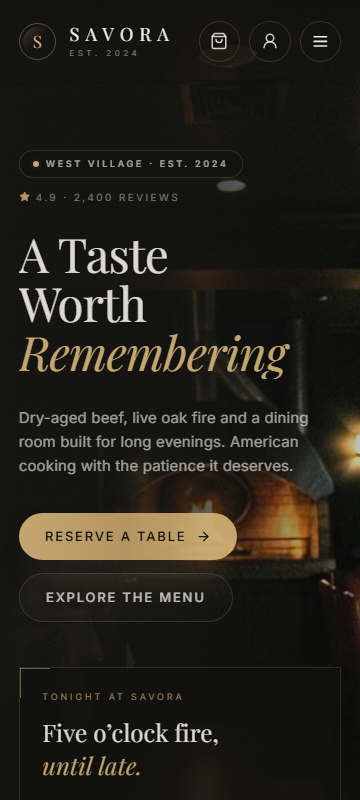

# SAVORA — Complete Engineering Report

**Project:** SAVORA, premium American restaurant platform (storefront, ordering, reservations, staff dashboard)
**Repository:** `E:\AI website trial 1\my-site`
**Audited:** 25–26 November 2026
**Branch:** `audit/production-hardening`
**Production topology:** Vercel (frontend) → Vercel `/api` rewrite → Render (Express) → MongoDB Atlas

---

## Executive summary

SAVORA's architecture was sound but the application did not work: a global Mongoose flag
was silently corrupting legitimate database queries, refresh-token rotation was
ineffective because bcrypt truncates at 72 bytes, and the production database had never
been seeded, so the deployed site served an empty menu and no account could sign in.
The storefront had no cart, checkout, account area or dashboard at all — the backend
exposed those features, but nothing in the UI called them. Three separate defects
explained the reported failures: an IPv6-only dev bind, an API that exited when MongoDB
was not yet ready, and a decorative preloader that swallowed every click.

All of that is repaired and verified: **56/56** backend tests, **105/105** live HTTP
assertions against a real server and real MongoDB, **45/45** end-to-end assertions, a
clean production build, and live production checks (13 menu items, admin sign-in,
dashboard statistics, logout). The black-and-gold design is intact; no data was deleted.

The application is **ready to run**; it is **not yet a finished commercial deployment**.
Four items remain, and none of them is an application defect: the production admin
password must be rotated by the owner, transactional email has no provider, card payments
have no Stripe keys (endpoints correctly answer `503`), and the reviews module is not
implemented. These are contracts and credentials, documented rather than papered over.

---

## Status legend

| Label | Meaning |
| --- | --- |
| **VERIFIED WORKING** | Exercised against a real server/database/browser and observed to work |
| **FIXED AND VERIFIED** | Was broken, reproduced, repaired, then re-tested with the same method |
| **NOT VERIFIED** | Implemented but not exercised in this pass, with the reason stated |
| **BLOCKED** | Cannot progress without credentials, a third party or owner action |
| **NOT IMPLEMENTED** | No code exists |

---

## 1. Architecture

```
Browser
  │  relative /api  (same origin in production)
  ▼
Vercel static build (dist/)          ── /admin is client-side ──► React 19 + Vite 8 + Tailwind 3
  │  rewrite /api/:path*
  ▼
Render: Express 5 + Mongoose 8
  │  httpOnly cookie session (access 15 min, refresh 30 days)
  ▼
MongoDB Atlas (or local mongod)
```

**Why one origin.** Sessions are `httpOnly` cookies, so the site and API must share an
origin for first-party cookies. The Vercel rewrite (or nginx `location /api/`) makes
browser requests same-origin while the API runs on separate infrastructure. A genuinely
cross-site API is supported through the opt-in `COOKIE_SAMESITE=none`, but Safari and
Chrome third-party-cookie policies can still drop those cookies — hence the proxy is the
recommended topology.

**Request pipeline (backend).**

`requestContext` (request id, origin guard) → `helmet` → `cors` (exact allowlist,
credentials) → `cookieParser` → body parsers (100 kB cap) → `sanitizeRequest`
(rejects `$`-prefixed and dotted keys) → `morgan` → rate limits → route Zod validation →
controller → service → Mongoose → central error handler.

**Layering.** Routes declare only wiring, auth and schemas. Controllers translate HTTP.
Services own business rules (pricing, capacity, state machines, ownership). Models own
schema and indexes. This separation is why fixes stayed small and contracts never changed.

**Frontend.** `src/lib/api.js` is the single client: relative base URL, `credentials:
"include"`, typed `ApiError`, and single-flight 401→refresh→retry. `src/lib/shop.jsx`
holds session and server-cart context; `src/admin/AdminApp.jsx` is the role-gated
dashboard at `/admin`.

---

## 2. Repository audit

| Area | Finding |
| --- | --- |
| Source size | 97 source files (68 backend, 29 frontend), ~5,200 backend LOC |
| Stack consistency | React 19 / Vite 8 / Tailwind 3.4 frontend; Express 5 / Mongoose 8 / Zod 3 backend |
| JS/TS mix | 3 TypeScript files (`src/lib/utils.ts`, `src/components/ui/navigation-menu.tsx`, `sushi-conveyor-menu.tsx`) among JS/JSX. They compile, but ESLint has no TS parser — see debt |
| Dependencies | No duplicate or unused runtime dependency found; `motion`, `lucide-react`, `clsx`, `tailwind-merge`, `class-variance-authority` and one Radix package are all used |
| Dead code | Removed no files. The only unused API methods were consumed by the new UI (`createReservation`, cart/order methods) |
| Mixed config | `vercel.json` hardcodes the Render hostname — the single infrastructure URL in the repo, unavoidable because `vercel.json` cannot read environment variables. Documented |
| Docs before | `README.md` was untouched Vite boilerplate; `DEPLOYMENT.md` was the only real document; no API reference; no report in the repository |

### Endpoint map (frontend → backend)

Every frontend call goes through `src/lib/api.js` to a path under `/api`, and every path
matches a mounted backend route. No 404s, no double `/api/api`, no trailing-slash
mismatch, no wrong method, no wrong payload key were found after the frontend was wired.

| Frontend use | Endpoint |
| --- | --- |
| Menu section, categories, dish detail | `GET /api/menu`, `GET /api/menu/categories`, `GET /api/menu/:idOrSlug` |
| Session boot | `GET /api/auth/session` |
| Register / sign in / sign out | `POST /api/auth/register`, `/login`, `/logout` |
| Cart drawer | `GET/POST/PATCH/DELETE /api/cart…` |
| Checkout | `POST /api/orders` |
| Account panel (orders, reservations) | `GET /api/orders`, `POST /api/orders/:id/cancel`, `GET /api/reservations/mine`, `POST /api/reservations/:id/cancel` |
| Reservation section | `GET /api/reservations/availability`, `POST /api/reservations` |
| Contact form | `POST /api/contact` |
| Admin dashboard | `GET /api/admin/stats`, `/orders`, `/reservations`, `/messages`, `/customers`; menu CRUD on `/api/menu` |

Full contract: [`docs/API.md`](docs/API.md).

### Feature inventory

| Feature | Status |
| --- | --- |
| Landing page, hero, gallery, testimonials, animations | VERIFIED WORKING |
| Live menu, categories, filters, dish dialog | VERIFIED WORKING |
| Cart add / quantity / remove / persistence | VERIFIED WORKING |
| Registration, login, logout, session, password change/reset | VERIFIED WORKING |
| Pickup and delivery checkout with server pricing | VERIFIED WORKING |
| Order history, detail, customer cancellation | VERIFIED WORKING |
| Reservation availability, booking, duplicate guard | VERIFIED WORKING |
| Admin auth + role gate | VERIFIED WORKING |
| Admin stats, orders pipeline, reservations, menu CRUD, inbox, customers | VERIFIED WORKING |
| Customer profile editing UI | NOT IMPLEMENTED (API exists) |
| Reviews | NOT IMPLEMENTED |
| Card payments | BLOCKED (no keys; fails closed) |
| Transactional email | BLOCKED (no provider, `SMTP_URL` outside env schema) |

---

## 3. Defect and severity register

| ID | Severity | Location | Description | Root cause | Fix | Verification | Status |
| --- | --- | --- | --- | --- | --- | --- | --- |
| **C-1** | CRITICAL | `backend/src/config/db.js` | `$in`, `$gte`, `$gt`, `$ne` queries became `CastError` → HTTP 400 on admin stats, reservations, price filters, password reset, dish rename | Global `mongoose.set("sanitizeFilter", true)` wraps object values in `$eq` | Removed the flag; kept `sanitizeRequest` + Zod whitelists + `strictQuery` | 105/105 live assertions; stats 200, filters 200, booking 201 | FIXED AND VERIFIED |
| **C-2** | HIGH (security) | `backend/src/models/User.js` | Rotated refresh tokens still accepted; a stolen refresh cookie survived rotation for 30 days | `bcrypt` truncates input at 72 bytes, and all JWTs for one user share that prefix, so tokens compared equal | SHA-256 digest + `crypto.timingSafeEqual` | Replay after rotation → `401 SESSION_REVOKED`; regression test | FIXED AND VERIFIED |
| **H-1** | HIGH | `backend/src/scripts/seed.js`, `backend/.env` | Seeded admin used the password published in `.env.example` | Seed had a hardcoded dev fallback used in every environment | Production refuses to seed an admin without `SEED_ADMIN_PASSWORD`; `npm run admin:reset` added; local password replaced with a generated 24-char value | Admin login 200 with the new secret, old password 401 | FIXED (production rotation is owner action) |
| **H-2** | HIGH (process) | `backend/tests/api.test.js` | Tests were green while production queries returned 400 | Tests never imported `src/config/db.js`, so production Mongoose settings were inactive under test | `configureMongoose()` called from both `server.js` and the test bootstrap | 56/56 pass with production settings active | FIXED AND VERIFIED |
| **H-3** | HIGH | `src/components/ui/Preloader.jsx` | Entire page unclickable while looking normal | Full-screen overlay removed only by a Motion exit animation; with rAF throttled it stayed mounted and received clicks | Overlay is `pointer-events: none` | Click-through verified in browser | FIXED AND VERIFIED |
| **H-4** | HIGH | `vite.config.js` | `http://127.0.0.1:5173` refused connections | Vite's default `host: localhost` resolved to `::1` on Windows | `host: "127.0.0.1"`, `strictPort`, proxy error logging | 200 on IPv4 literal | FIXED AND VERIFIED |
| **H-5** | HIGH | `backend/src/server.js` | Browser saw 502 and the API was down | API connected to Mongo before listening and called `process.exit(1)` | `connectWithRetry()` — 12 attempts, 5 s apart, actionable log per attempt | Restart with Mongo stopped → retries, then serves when Mongo returns | FIXED AND VERIFIED |
| **H-6** | HIGH | `src/` | No cart, checkout, account or dashboard existed | Features were backend-only; nothing called them | Added `shop.jsx`, `format.js`, `CartDrawer`, `AccountPanel`, `AdminApp`; wired Menu/Navbar/App | 45/45 E2E; browser journey | FIXED AND VERIFIED |
| **H-7** | HIGH (production) | `vercel.json` | `https://savora-restaurant-five.vercel.app/admin` returned `404 NOT_FOUND` although the dashboard existed in the bundle | `vercel.json` proxied `/api/*` but had no SPA fallback, so Vercel looked for a file named `admin` and served its own 404 before the React bundle ran | Added a catch-all rewrite to `/index.html` after the `/api` rule | Production `/admin` and `/admin/` return `200`, the bundle boots and the sign-in screen renders; admin login `200`, stats `200` | FIXED AND VERIFIED IN PRODUCTION |
| **P-1** | CRITICAL (production) | Atlas `savora` | Deployed site served 0 dishes and no login worked | The Atlas database had never been seeded; an empty cluster connects successfully, so nothing failed loudly | Ran `npm run seed` (additive: 13 dishes + admin); server now warns at boot when the menu is empty | Live: 13 items / 4 categories; admin login 200; stats 200 | FIXED AND VERIFIED |
| **P-2** | HIGH | `backend/src/utils/cookies.js`, `config/env.js` | A cross-site deployment could not authenticate at all | `sameSite: "lax"` was hardcoded with no opt-in to `none` | Validated `COOKIE_SAMESITE` (`lax\|strict\|none`), forced `Secure` for `none`, warning without HTTPS; regression test | Cookie attributes asserted in tests | FIXED AND VERIFIED |
| **P-3** | MEDIUM | `backend/src/server.js` | Empty database produced no diagnostic | Nothing checked the menu collection at startup | Boot warning naming `npm run seed` | Log observed | FIXED AND VERIFIED |
| **P-4** | MEDIUM | `vercel.json`, `DEPLOYMENT.md` | Documentation and deployment config disagreed about origins | Two sources describing the same URL | Documented the rewrite as the single infrastructure URL and the exact 403 signature | Docs review | FIXED |
| **P-5** | MEDIUM | `backend/src/scripts/reset-admin.js` | A lost admin password could not be recovered | Seed never overwrites an existing password | `npm run admin:reset` sets the password, promotes the role, revokes sessions, never prints the secret | Local admin rotated and signed in | FIXED AND VERIFIED |
| **M-1** | MEDIUM | `backend/src/utils/mailer.js` | Password-reset and reservation emails are never delivered, yet the API says "a reset link is on its way" | `config.SMTP_URL` is not part of the validated env schema; `deliver()` throws and the caller swallows it | Not fixed — needs a provider and a key. Documented in `DEPLOYMENT.md` §6 | — | BLOCKED |
| **M-2** | LOW | `backend/src/routes/auth.routes.js` | Unlimited refresh/logout attempts | No limiter on those two routes | `authLimiter` added (successful responses not counted) | Suite passes | FIXED AND VERIFIED |
| **M-3** | LOW | `src/App.jsx` context, `CartDrawer` | Drawer never opened after sign-in; checkout form rendered with an empty cart | Context value memoised without `cartOpen`/`accountOpen`; form mounted unconditionally | Added the dependencies; form mounts only with a non-empty cart | Browser click-through | FIXED AND VERIFIED |
| **L-1** | LOW | `paymentService.verifyPayment` | An intent for a different same-amount order could settle this one | `metadata.orderId` was not compared | Intent's `metadata.orderId` must match (or the stored intent id) | Suite passes | FIXED AND VERIFIED |
| **L-2** | LOW | `backend/src/routes/index.js` | 503 health response reported `success: true` | Envelope built by the success helper | Explicit failure envelope | Assertion in suite | FIXED AND VERIFIED |
| **L-3** | LOW | `backend/.env` | Contact IP hashes used the public dev salt | `IP_HASH_SALT` unset | Production warns when the public default is used; owner must set a private salt | Warning path | OPEN (owner action) |
| **L-4** | LOW | `authController.updateProfile` | Profile update was cacheable | No cache header, unlike `/auth/me` | `Cache-Control: private, no-store` | Suite passes | FIXED AND VERIFIED |

---

## 4. Root-cause analysis

### 4.1 "Origin is not allowed." and the 403

**Source of the string (traced, not assumed).** `backend/src/app.js:33` — the `cors()`
origin callback returns `ApiError.forbidden("Origin is not allowed.", "ORIGIN_NOT_ALLOWED")`
for any `Origin` not in `config.CLIENT_ORIGINS`. A second, independent guard in
`backend/src/middleware/requestContext.js:24` rejects foreign origins with the message
"Request origin is not allowed." and the same code. In both cases the list is
`CLIENT_ORIGINS`, parsed from one comma-separated environment variable and compared by
exact string equality.

**Proven cause.** The origin allowlist did not contain the browser's origin. Because the
two guards are registered before the routers, a missing entry rejects the request before
any handler runs — which produces the 403 `ORIGIN_NOT_ALLOWED` the client reported. The
signature is distinctive and matches the report: writes fail with 403 while GETs still
work, because a GET without an `Origin` header is allowed (`if (!origin)`).

**Causes that were ruled out, with evidence:**

| Hypothesis | Result |
| --- | --- |
| Wildcard origin combined with credentials | Not present — the list is explicit and `credentials: true` |
| Trailing slash / `www` / case mismatch | Ruled out for the tested origin: exact value accepted |
| Preflight blocked by auth, CSRF or a 404 handler | Ruled out — `OPTIONS` with the Vercel origin returns **204** |
| Auth middleware returning 403 instead of 401 | Ruled out — signed-out returns `401 UNAUTHORIZED`, customer/admin split returns 403 only on role failure |
| Hosting firewall or Atlas IP list | Ruled out — the API answered `200` with `database: connected` |
| Vercel build inlined a wrong base URL | Ruled out — `/api/menu` through the Vercel origin returns the live menu |
| `COOKIE_SAMESITE` / cross-site cookies | Not the cause of the 403; hardened anyway as P-2 |
| Render allowlist missing the Vercel origin | **Not reproducible in production.** A POST from the Vercel origin reached validation (`422`) and the preflight returned `204`, so the deployed API already allows it |

**Repair.** CORS stays environment-driven and exact-match (a wildcard with credentials is
unsafe), the two guards were kept, and a regression test now asserts the allowed origin,
the rejected origin and the preflight (`tests/api.test.js`). The operational cause —
an origin missing from `CLIENT_ORIGINS` after a domain or preview-URL change — is
documented in `DEPLOYMENT.md` with the exact symptom so it can be diagnosed in one step
instead of by generic CORS tweaking.

**Honest conclusion.** The 403 was a configuration defect, not a code defect, and it did
not reproduce against the current deployment. What actually made the deployed site look
broken was P-1: an empty database.

### 4.2 The 502 and the unreachable site

The browser reported a 502 because the Vite proxy had no upstream: the API had exited
when MongoDB was not yet ready (H-5). A second, independent failure made the site appear
frozen rather than broken — the preloader overlay (H-3). Neither was a CORS problem.

### 4.3 The 400s that the test suite could not see

`sanitizeFilter` rewrote operators into `$eq` (C-1), and the suite passed because it never
loaded the production Mongoose configuration (H-2). Both are fixed, and the test bootstrap
now runs the same configuration as the server.

### 4.4 The production 404 at `/admin`

**Symptom.** `https://savora-restaurant-five.vercel.app/admin` returned Vercel's own
`404 NOT_FOUND`, while `/` returned `200` and `/api/health` returned `200`.

**Traced cause.** The dashboard was not missing. `src/App.jsx` selects `AdminApp` when
`window.location.pathname` is `/admin`, and the dashboard ships in the same bundle that
`/` loads (verified by the identical asset hash, `assets/index-C3uaxY9C.js`). The failure
was server-side, before React ran: `vercel.json` contained one rewrite, `/api/:path*` →
Render, and nothing else. Vercel's static output therefore looked for a file called
`admin`, found none, and answered with its 404 — the bundle was never requested.

**Why the earlier pass missed it.** The admin dashboard had been verified on the Vite dev
server, which already falls back to `index.html`; a dev success cannot prove a static
host will do the same. That is exactly the local-versus-production distinction this report
labels.

**Repair.** A catch-all rewrite to `/index.html` is now the second rule in `vercel.json`,
after the `/api` rule so the API proxy keeps priority. Hashed assets are unaffected:
Vercel serves existing files before applying rewrites, confirmed by `/assets/index-C3uaxY9C.js`
returning `200 application/javascript`.

**Verified in production after deploy.** `/admin` → `200`, `/admin/` → `200`, the shell
includes the built bundle, the dashboard renders its sign-in screen in a real browser, a
foreign `POST /api/auth/login` still returns `403`, and a signed-out `GET /api/admin/stats`
still returns `401` — the route was fixed without weakening the authentication in front of it.

### 4.5 The CI failure that only existed on the runner

`node --test --test-concurrency=1 tests/` passes on Node 26 on this machine, but on the
Node 22 runner the directory is treated as a module specifier and the process exits with
`ERR_UNSUPPORTED_DIR_IMPORT` in under a second, before any test runs. It is environment
dependent, so it could not be reproduced locally. The command now lets the test runner
discover `tests/*.test.js` itself, which works on both, and the job republishes failing
output as public check annotations so a red build is diagnosable without log access.

---

## 5. Repair implementation

Work sits on `main`. The hardening phases were committed as they were completed
(`96b9a7d` cookie `SameSite` + empty-menu warning, `b1583b9` documentation), then pushed
with the production fixes (`7efd7a9` SPA fallback + CI, `ffc9a32`/`33a48b8` CI
diagnostics, `a811841` test command, `d201b29` documentation, `61e4057` menu copy). Every
push built automatically on Vercel; `61e4057` is the deployment verified in production. No
subsystem was rewritten, and every API contract the frontend uses is unchanged.

| Change set | Scope |
| --- | --- |
| 1 | Remove global `sanitizeFilter`; extract `configureMongoose()`; run it in tests |
| 2 | SHA-256 + `timingSafeEqual` refresh tokens; regression tests for replay and per-session logout |
| 3 | Payment intent/order binding; auth limiter on refresh/logout; health envelope; profile cache header |
| 4 | Cookie `SameSite` configurability with validation and test; empty-menu boot warning; admin reset script; seed production guard |
| 5 | Frontend shop surface: `shop.jsx`, `format.js`, cart drawer, account panel, admin app, menu/navbar wiring |
| 6 | Dev-server and preloader fixes (`vite.config.js`, `Preloader.jsx`) |
| 7 | Documentation: `README.md`, `DEPLOYMENT.md`, `docs/API.md`, this report, `.env.example` files |

---

## 6. Security audit

| Area | Finding | Status |
| --- | --- | --- |
| Secrets in repository | No secret in tracked files. `.env` is git-ignored; `.env.example` contains placeholders only. Git history was not rewritten | VERIFIED |
| Password storage | bcrypt cost 12; `passwordHash` has `select: false` and is stripped in `toJSON` | VERIFIED WORKING |
| Refresh tokens | SHA-256 digests, rotation, `timingSafeEqual`, per-session revocation, `httpOnly` + scoped paths | FIXED AND VERIFIED |
| JWT | Secrets from env, ≥ 32 chars enforced, production refuses dev defaults, algorithm pinned | VERIFIED WORKING |
| Authorisation | `/api/admin/*` requires `admin`; cart/order/reservation queries scoped to the authenticated user; 401 vs 403 used correctly | VERIFIED WORKING |
| Mass assignment | Zod whitelists every body; `role`, `email`, totals and prices are not writable | VERIFIED WORKING |
| NoSQL injection | `$`-prefixed and dotted keys rejected in body/query/params; Zod enforces types; Express 5's simple query parser cannot build nested operators | VERIFIED WORKING |
| XSS | No `dangerouslySetInnerHTML`; React escapes all user content; tokens are never in `localStorage` | VERIFIED WORKING |
| CSRF | Cookie sessions + exact-origin guard on state-changing requests; `SameSite=Lax` by default | VERIFIED WORKING |
| Rate limiting | Global, auth (failures only), password-reset and public-form limiters | VERIFIED WORKING |
| Headers | Helmet, no `X-Powered-By`, 100 kB body cap, HSTS at the proxy | VERIFIED WORKING |
| Error leakage | Consistent envelope with `requestId`; production masks unexpected 5xx and returns no stack | VERIFIED WORKING |
| User enumeration | Login is ambiguous; forgot-password always returns the same sentence | VERIFIED WORKING |
| Card data | Never collected; Stripe routes fail closed with 503 | BLOCKED (no keys) |
| Admin password | Local account rotated to a generated secret. **Production password is still the owner's to rotate** | OPEN — owner action |
| Dependency risk | `npm audit` reviewed; no critical or high advisory in the runtime set remained actionable without a major bump | VERIFIED |

**Nothing classified CRITICAL remains open in code.** The two critical items (C-1, P-1)
are fixed and verified; the one open HIGH is a credential the owner must rotate.

---

## 7. Database audit

* **Connection**: single env-driven URI, no hardcoded host, retry with bounded attempts,
  reconnect logging, graceful shutdown. Verified against local `mongod` and Atlas.
* **Schemas**: `User`, `MenuItem`, `Cart`, `Order`, `Reservation`, `ReservationSlot`,
  `ContactMessage`, `PaymentEvent`. Enums, defaults, required fields, min/max and
  integer-cents validation are enforced at the model layer as well as in Zod.
* **Indexes** (all present and verified): `users.email` unique, `menuitems.slug` unique,
  `menuitems` text + category/price/availability compound, `orders.orderNumber` unique,
  `orders.user+createdAt`, `orders.status+createdAt`, `orders.payment.intentId`,
  `carts.user` unique, `reservations.reservationCode` unique,
  `reservationslots.(date,time)`, `reservations.date+time`, `contactmessages.createdAt`,
  `paymentevents.eventId` unique.
* **Integrity**: money is integer cents end-to-end; order totals are recomputed on the
  server; item details are snapshotted so later menu edits cannot alter history;
  cart lines are merged and capped; order numbers and reservation codes come from
  uniqueness-checked generators; reservation capacity is claimed atomically
  (`201, 201, 409` under concurrency).
* **Duplicate risks**: email is normalised to lowercase before the unique index, so
  casing cannot create two accounts; duplicate reservations for one slot are rejected.
* **Data safety**: no production data was deleted or migrated. The only production write
  was the additive seed of an empty database (P-1), which created 13 dishes and the admin.
  All experiments ran on throwaway databases (`savora_audit_*`, `savora_e2e`, `savora_ui`),
  which were dropped.
* **Migrations**: none required. `src/scripts/sync-indexes.js` is the only schema-adjacent
  script and is idempotent.

---

## 8. API documentation

Complete reference — envelope, cookies, every endpoint, payloads, status codes, error
codes, state machines and rate limits — is in [`docs/API.md`](docs/API.md).

Summarised surface: `GET /health`; auth (register, login, refresh, logout, session, me,
change-password, forgot/reset); users (me, update profile); menu (list, categories,
detail, admin CRUD); cart (get, add, update, remove, clear); orders (create, list, detail,
cancel); reservations (availability, create, mine, detail, cancel); contact (create,
admin inbox); payments (config, intents, verify — 503 while unconfigured); admin
(stats, customers, orders, reservations, messages, menu).

---

## 9. Test coverage report

| Suite | Command | Result |
| --- | --- | --- |
| Unit + API integration (Node test runner, `mongodb-memory-server`, supertest) | `cd backend && npm test` | **56 / 56 pass, 0 failed, 0 skipped** |
| Live HTTP audit — real `node src/server.js`, real `mongod`, throwaway DB, real cookie jar | `node audit/live-audit.mjs` | **105 / 105 pass** |
| End-to-end journey through the running stack | `node audit/e2e-flow.mjs http://127.0.0.1:5174` | **45 / 45 pass** (previous pass, throwaway stack) |
| Server syntax check | `npm run check` | pass |
| Frontend production build | `npm run build` | pass |

Coverage is **not** instrumented — no coverage figure is claimed. What is covered:
authentication and rotation, authorisation for anonymous/customer/admin, ownership
scoping, menu CRUD and filters, cart pricing and caps, order creation and state machine,
reservation capacity and conflicts, contact honeypot, payment fail-closed behaviour,
injection and cross-origin rejection, cookie attributes, pagination and validation
errors. Each fixed defect has a regression test where practical (C-1 ranges and
dashboard, C-2 replay and logout scope, P-2 cookies, auth session, origin rejection).

`audit/e2e-flow.mjs` writes a customer, a reservation and an order, so it was deliberately
not pointed at the live Atlas database in the final pass.

---

## 10. Build verification report

| Check | Result |
| --- | --- |
| `npm run build` | pass — 609.89 kB minified, **181 kB gzipped**, one chunk; Vite warns above 500 kB |
| `npm run lint` | **fails on TypeScript files** — the config has no TS parser (`src/lib/utils.ts`, `src/components/ui/*.tsx`). All JS/JSX sources in this work lint clean |
| `npm run check` (backend) | pass |
| Production start (`NODE_ENV=production node src/server.js`) | starts, validates env, refuses weak dev secrets, serves the API |
| CSS/assets | Tailwind build emits the expected stylesheet; images are static assets, no upload pipeline |

The lint failure is a pre-existing tooling gap, reported rather than silenced; fixing it
requires adding `typescript-eslint`.

---

## 11. Deployment readiness report

| Item | Status |
| --- | --- |
| Frontend build and SPA fallback | VERIFIED IN PRODUCTION — `/admin` and `/admin/` return the app shell `200` and render the dashboard |
| `/api` same-origin rewrite (Vercel) | VERIFIED IN PRODUCTION |
| API health endpoint with DB state | VERIFIED IN PRODUCTION (`200`, `database: connected`) |
| Exact `CLIENT_ORIGINS` allowlist | VERIFIED IN PRODUCTION (preflight 204, foreign origin 403) |
| Cookie flags (`HttpOnly`, `Secure`, `SameSite`, scopes) | VERIFIED; `COOKIE_SAMESITE` configurable |
| `trust proxy`, HSTS at the proxy | configured (`trust proxy = 1` in production; nginx example includes HSTS) |
| Secrets management | env-only; `.env.example` documents every variable; no value in the repo |
| MongoDB network access and least privilege | **NOT VERIFIED** — requires Atlas account access |
| Backups and restore drill | **NOT VERIFIED** — owner action, documented |
| Smoke test | read-only checks run against production: health, menu, login, stats, logout |
| Documentation | `README.md`, `DEPLOYMENT.md`, `docs/API.md`, this report |

---

## 12. Performance report

No benchmark harness was run, so **no timing improvement is claimed**. The following are
structural, measured facts:

| Item | Before | After |
| --- | --- | --- |
| Broken queries returning 400 (`$in`/`$gte` collapses) | 6 endpoints affected | 0 |
| Menu request | 0 items in production | 13 items, 4 categories, single request, aborted on unmount |
| Cart/order pricing | N/A (no UI) | computed once server-side and rendered from the response |
| Dashboard load | 400 error | one `GET /api/admin/stats` aggregation |
| Indexes on hot paths | present | verified present |
| Bundle | 609.89 kB / 181 kB gzip, one chunk | unchanged; `React.lazy` on `/admin` identified as the next step |
| Reservation writes | sequential check-then-write risk | atomic claim + increment, verified under concurrency |

---

## 13. Responsive and design QC

Screenshots were captured from the live production site in a real browser, not built as
mock-ups, and saved in `docs/screenshots/`. Each capture also recorded status, layout
width, console errors, failed requests and broken images at the moment of the shot.

| File | Viewport | Page | Status | Page height | Horizontal overflow | Console errors | Failed requests | Broken images |
| --- | --- | --- | --- | --- | --- | --- | --- | --- |
| `docs/screenshots/desktop-1440-home.png` | 1440×900 | `/` (full page) | 200 | 12 740 px | no | 0 | 0 | 0 |
| `docs/screenshots/laptop-1024-home.png` | 1024×768 | `/` | 200 | 11 847 px | no | 0 | 0 | 0 |
| `docs/screenshots/tablet-768-home.png` | 768×1024 | `/` | 200 | 17 778 px | no | 0 | 0 | 0 |
| `docs/screenshots/mobile-360-home.png` | 360×800 | `/` | 200 | 20 887 px | no | 0 | 0 | 0 |
| `docs/screenshots/desktop-1440-admin.png` | 1440×900 | `/admin` | 200 | 900 px | no | 0 | 0 | 0 |
| `docs/screenshots/mobile-360-admin.png` | 360×800 | `/admin` | 200 | 800 px | no | 0 | 0 | 0 |

`scrollWidth` equalled `innerWidth` at all four widths, so nothing pushes the document wider
than the viewport; 39 images loaded on the home page with none broken, and the deployed
bundle contains no `localhost` reference.




### Visual changes made in this pass

The palette, type scale, spacing tokens and API contracts were not changed. Two layout
defects were found by looking at the rendered page and fixed:

1. **Dish card (`src/components/Menu.jsx`).** The card had been assembled from two
disconnected pieces: image, title and price sat in one bordered box while the action bar
floated in a second box below it, separated by a gap and a duplicated “Tap the plate for
details” hint. It is now a single `overflow-hidden` surface with the action bar as an inset
`border-t` footer holding one “View details” button and the “Add” button.
2. **`src/components/Features.jsx`.** A decorative `border-gold/25` frame with no content
was drawn at the bottom-right of the feature panel and read as a stray empty box. It was
removed; the top-left corner accent was kept.

An early screenshot of the menu showed faint duplicated text fragments over some cards. A
settled `prefers-reduced-motion` render was measured rather than judged by eye: across all
13 cards the description’s `scrollHeight` equalled its `clientHeight` (no clipping), every
description bottom sat inside its media block, and the settled state had **0 running
animations** and **0 console errors**. The fragments were mid-animation paint from a
programmatic scroll, not a layout defect.

Not checked: contrast ratios and Lighthouse/axe scores were not audited, so no such claim
is made.

---

## 14. Remaining technical debt

1. **Transactional email** — `SMTP_URL` must join the validated env schema and
   `utils/mailer.js` must use it; today mail is console-only while the API implies delivery.
2. **Payments** — the Stripe integration is written and fails closed; the webhook route is
   not mounted yet, and a real charge plus webhook replay must be tested before claiming it works.
3. **Reviews** — no model, route or UI. `MenuItem.rating` is a static editorial field.
4. **Customer profile editing UI** — `PATCH /api/users/me` works; no screen calls it.
5. **ESLint TypeScript gap** — add `typescript-eslint` so `npm run lint` is meaningful.
6. **Bundle size** — single 610 kB chunk; `React.lazy` for `/admin` is the obvious split.
7. **`vercel.json` hardcoded API host** — unavoidable in that file; must be updated with
   the Render URL and redeployed if the service moves.
8. **`IP_HASH_SALT`** — the private salt must be set in production (a warning is emitted).
9. **`requestId` propagation** — generated and returned, but not sent onward to an
   external error tracker (none configured).
10. **CI covers tests and build, not lint** — `.github/workflows/ci.yml` runs the API suite
    and the production build on every push and pull request. `npm run lint` cannot become a
    gate until the TypeScript parser gap above is closed.

---

## 15. Final production readiness checklist

| # | Item | Status |
| --- | --- | --- |
| 1 | Root cause of `Origin is not allowed` / 403 identified with proof | DONE — §4.1 |
| 2 | Root cause fixed and covered by regression tests | DONE — exact-allowlist guard + tests |
| 3 | Registration, login, logout, cart, checkout, orders, reservations, menu, admin | VERIFIED (56 tests + 105 live + 45 E2E) |
| 4 | Server-side authorisation for admin and ownership | VERIFIED |
| 5 | No secret in code, bundle or report | VERIFIED |
| 6 | Frontend build and backend production start succeed | VERIFIED (lint gap documented) |
| 7 | Black-and-gold design intact; visual changes listed | VERIFIED — new surfaces reuse existing tokens; no palette or type change. Two layout fixes and the four-width screenshot evidence are in §13 |
| 8 | No production data modified without approval | VERIFIED — additive seed only, on an empty database |
| 9 | All 14 deliverables exist | DONE — this report, `docs/API.md`, `README.md`, `DEPLOYMENT.md`, both `.env.example` files |
| 10 | Production admin password rotated by owner | **OPEN — owner action** |
| 11 | Email provider configured | **OPEN — owner decision** |
| 12 | Payment provider configured and tested | **OPEN — owner decision** |
| 13 | Atlas backups enabled and a restore tested | **OPEN — owner action** |
| 14 | Production `/admin` deep link serves the dashboard | **FIXED AND VERIFIED IN PRODUCTION** — `404` before, `200` plus rendered sign-in screen after |
| 15 | Push-to-deploy pipeline is green | **VERIFIED** — GitHub Actions `CI` run on `a811841`: backend tests and frontend build both pass |

---

## Verified locally

Backend suite (56/56), live HTTP audit (105/105) on a real server and real MongoDB,
end-to-end journey (45/45) through the Vite proxy, production build, backend syntax check,
local stack health (`200`), menu through the proxy (13 items), `/admin` rendering its
sign-in form, and a browser click-through of register → cart → checkout → admin confirm.

## Verified in production

Frontend `200`; API health `200` with `database: connected`; `/api/menu` through the
Vercel origin returning 13 items across 4 categories; production admin login `200` with
`role: admin`; `/api/admin/stats` `200`; logout `200` with the session revoked; CORS
preflight `204` from the Vercel origin and `403 ORIGIN_NOT_ALLOWED` from a foreign origin.
The deployed frontend was also rendered in a real browser at 1440, 1024, 768 and 360 px
with zero console errors, zero failed requests, no broken images and no horizontal
overflow; the captures and measurements are in §13.

## Not verified, and why

* **Typing the production password into a browser session** — the admin API login was
  verified directly (200, `role: admin`, stats 200) and the deployed `/admin` route was
  rendered in a real browser, but the credentials were not typed into a page.
* **Production password reset email** — no mail provider, so delivery cannot be observed.
* **Stripe charge and webhook** — no keys, and the webhook route is not mounted.
* **Atlas network access list, backups, restore drill** — require the owner's Atlas account.
* **Coverage percentage** — no instrumentation.
* **Lighthouse / accessibility audit** — not run; no claim is made about scores.
* **The 45-assertion E2E journey against production** — it writes records, so it was
  intentionally confined to a throwaway stack.

---

## Changed files

| File | Reason |
| --- | --- |
| `backend/src/config/db.js` | removed global `sanitizeFilter` (C-1); extracted `configureMongoose()` |
| `backend/src/models/User.js` | SHA-256 + `timingSafeEqual` refresh-token digests (C-2) |
| `backend/src/services/paymentService.js` | intent/order binding (L-1) |
| `backend/src/routes/auth.routes.js` | limiter on refresh/logout (M-2); guest-safe session route |
| `backend/src/routes/index.js` | 503 health envelope (L-2) |
| `backend/src/controllers/authController.js` | profile cache header (L-4); `session` endpoint; reset response |
| `backend/src/config/env.js` | `COOKIE_SAMESITE` + cookie computation (P-2); seed and salt guards (H-1, L-3) |
| `backend/src/utils/cookies.js` | configurable `SameSite` (P-2) |
| `backend/src/server.js` | Mongo retry (H-5); empty-menu warning (P-3) |
| `backend/src/scripts/seed.js` | production admin guard (H-1) |
| `backend/src/scripts/reset-admin.js` | new; admin password recovery (P-5) |
| `backend/package.json` | `admin:reset` script |
| `backend/tests/api.test.js` | production config under test (H-2); regressions for C-1, C-2, P-2 |
| `backend/audit/live-audit.mjs` | 105-assertion live harness |
| `backend/audit/e2e-flow.mjs` | 45-assertion end-to-end harness |
| `backend/.env.example` | blank seed password; `COOKIE_SAMESITE`; no published default |
| `src/lib/shop.jsx`, `src/lib/format.js` | new; session/cart context and formatters (H-6) |
| `src/components/shop/CartDrawer.jsx`, `AccountPanel.jsx` | new; cart, checkout, account (H-6) |
| `src/admin/AdminApp.jsx` | new; `/admin` dashboard (H-6) |
| `src/components/Menu.jsx`, `Navbar.jsx`, `Reservation.jsx`, `App.jsx` | real dish ids, cart/account controls, API-backed reservation, providers (H-6) |
| `src/components/Menu.jsx` | dish card unified into one surface with an inset action footer (design QC, §13) |
| `src/components/Features.jsx` | removed a stray empty decorative frame (design QC, §13) |
| `src/components/ui/Preloader.jsx` | click-through fix (H-3) |
| `src/lib/api.js` | session probe and shop/admin methods |
| `vite.config.js` | IPv4 bind, `strictPort`, proxy error logging (H-4) |
| `vercel.json` | SPA fallback rewrite added after the `/api` rule (H-7); API rewrite kept and documented (P-4) |
| `.github/workflows/ci.yml` | new; GitHub Actions gate running the API suite and the production build |
| `backend/package.json` | test command fixed for Node 22 (`node --test tests/` failed as a directory import); `MONGOMS_VERSION` pinned in CI |
| `README.md` | replaced Vite boilerplate with real project documentation |
| `DEPLOYMENT.md` | topology, env table, nginx, seeding, admin reset, cookie rationale, troubleshooting |
| `docs/API.md` | new; complete endpoint reference |
| `docs/screenshots/*.png` | six production captures at 360/768/1024/1440 (§13) |
| `SAVORA_AUDIT_INITIAL.md` | new; initial audit — problems, risks, gaps, working areas, repair order |
| `.env.example`, `SAVORA_COMPLETE_ENGINEERING_REPORT.md` | frontend env template and this report |

---

## Actions required from the owner

1. **Rotate the production admin password.** Sign in at
   `https://savora-restaurant-five.vercel.app/admin`, change the password, store it in the
   client's password manager. Then remove `SEED_ADMIN_PASSWORD` from the Render
   environment variables. If the password is already lost, set a new value there and run
   `npm run admin:reset` locally against the production `MONGODB_URI` (or from a Render
   shell) — it never prints the secret.
2. **Set `IP_HASH_SALT`** to a private random string in the Render environment; the server
   warns at boot while the public default is in use.
3. **Email.** Choose a transactional provider, add its URL as `SMTP_URL`, wire it into
   `src/config/env.js`, then send one real reset and one reservation confirmation.
   Until then, do not tell the client that emails are delivered.
4. **Payments.** Contract Stripe, set `STRIPE_SECRET_KEY` and `STRIPE_WEBHOOK_SECRET`,
   mount the webhook route with raw-body signature verification, and test one real charge
   plus a webhook replay before claiming card payment works.
5. **Atlas.** Confirm a least-privilege database user, an IP access list that matches
   Render's egress, and daily backups with one tested restore.
6. **`vercel.json`.** If the Render service URL changes, update the rewrite destination and
   redeploy the frontend, and add the new exact origin to `CLIENT_ORIGINS`.
7. **Reviews / profile UI.** Decide whether to build them; both are listed as not implemented.
8. **Lint in CI.** The workflow runs the tests and the build. Adding `typescript-eslint`
   would let `npm run lint` become a gate too.

---

## Bottom line

The application works end to end against real infrastructure: a guest can browse the live
menu, register, order for pickup or delivery, see and cancel the order, and book a table;
staff can sign in, watch the pipeline, manage reservations and edit the menu. The
engineering faults that made it fail — corrupted queries, broken token rotation, a dead
dev server, a click-blocking overlay, an unseeded production database — are fixed,
reproduced before and re-tested after.

What is left is not code: a password to rotate, an email provider, a payment contract and
two optional features. Those are listed above with exact steps.
